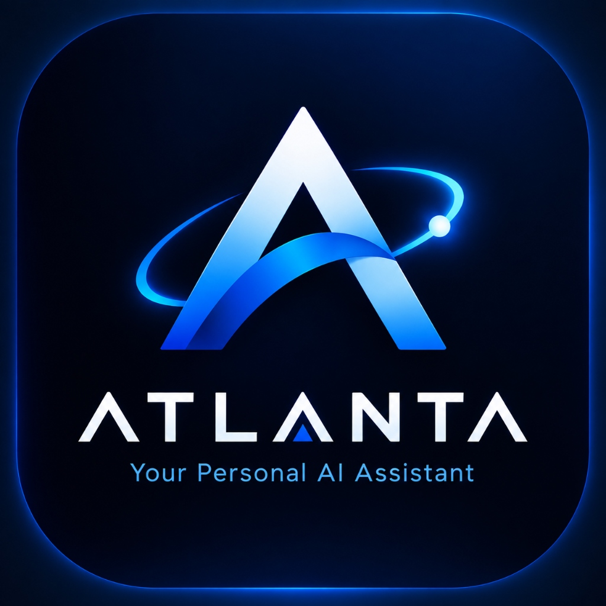

# ⚡ ATLANTA — Personal AI Assistant

<p align="center">
  
</p>

<p align="center">
  <strong>Next-Generation Personal AI Assistant & Cyber-Tech Command Center</strong><br>
  <em>Inspired by J.A.R.V.I.S. • Powered by Google Gemini Pro & Flutter • Engineered for Landscape Mobile & Desktop</em>
</p>

<p align="center">
  
  
  
  
  
</p>

---

## 🌌 Overview

**ATLANTA** is an intelligent, cross-platform personal AI assistant designed to function as a private holographic command center. Built with a futuristic cyber-tech visual identity, ATLANTA communicates through natural voice synthesis, executes multi-turn conversational reasoning, automates smart routines, manages daily productivity, and controls connected hardware nodes.

---

## ✨ Key Features

### 🧠 1. Neural AI Brain & Voice Engine
* **Cloud Gemini Pro / Flash 2.5 Integration**: Leverages Google AI Studio models with multi-turn conversation memory and proactive intent recognition.
* **Natural Voice Interaction**: High-fidelity speech recognition and customizable female voice synthesis that addresses the user as *"Boss"*.
* **HQ Cybernetic Audio Suite**:
  * Cinematic 6-second boot chime during the splash screen.
  * Welcoming greeting audio upon dashboard entry (*"Hello Boss! Its Atlanta at your service"*).
  * Synchronized haptic click SFX, holographic scanning sounds, and success chimes.

### 🖥️ 2. Futuristic Cyber-Tech HUD & Command Center
* **Landscape-First Mobile Optimization**: Tailored specifically for horizontal orientation (smartphones, foldables, and tablets).
* **Glassmorphic Cyber Design**: True `BackdropFilter` frosted glass containers with electric cyan (`#00F2FE`) and primary blue gradients.
* **Dynamic Neon Glows & Visual Telemetry**:
  * Real-time rotating HUD coordinate rings and scanner lines.
  * Reactive audio waveforms and pulsing 3D-effect assistant orb.
  * Active device illumination and priority badge glows.

### 📋 3. Productivity & Command Modules
* **My Tasks**: Categorized task scheduler (Today, Upcoming, Completed) with priority indicators and search.
* **Neural Notes**: Google Keep-style quick notes with custom cyber hues, pinned notes, and swipe-to-delete.
* **Neural Reminders**: Time-based alerts with one-tap snooze and audible alarms.
* **Connected Devices & Hardware Mesh**: Real-time terminal monitors (PC Node, Mobile Node) and IoT controls (lights, thermostats, mainframe power) with dimming and power sliders.
* **Neural Protocols (Automations)**: Automated multi-step routines with live progress execution and visual telemetry.
* **App Launcher**: Voice-activated native application launcher for system apps (Clock, Camera, Settings, YouTube, and installed apps).

---

## 🛠️ Technology Stack

| Layer | Technologies |
| :--- | :--- |
| **Framework** | [Flutter](https://flutter.dev) (Dart 3) |
| **AI Model Engine** | Google Gemini Pro & Flash 2.5 API via AI Studio |
| **Voice & Audio** | `speech_to_text`, `flutter_tts`, `audioplayers` |
| **State & Navigation** | `go_router`, Reactive Service Architecture |
| **Design & UI** | Vanilla Flutter CustomPainters, Glassmorphism, Google Fonts (Orbitron & Rajdhani) |
| **Persistence** | `shared_preferences`, SQLite / Supabase backend ready |

---

## 🚀 Getting Started

### Prerequisites
* [Flutter SDK](https://docs.flutter.dev/get-started/install) (3.24+ recommended)
* [Android SDK](https://developer.android.com/studio) with API Level 34+
* Dart SDK 3.5+

### Installation & Run

1. **Clone the repository:**
   ```bash
   git clone https://github.com/ImranHasan13421/ATLANTA.git
   cd ATLANTA
   ```

2. **Install dependencies:**
   ```bash
   flutter pub get
   ```

3. **Run on connected device (Landscape):**
   ```bash
   flutter run -d android
   ```
   *Or for Windows desktop:*
   ```bash
   flutter run -d windows
   ```

4. **Run Unit & Widget Tests:**
   ```bash
   flutter test
   ```

---

## 📦 Building Android Release APK

To generate the standalone production APK:

```bash
flutter build apk --release
```

The compiled package will be located at:
```
build/app/outputs/flutter-apk/app-release.apk
```

---

## 🛡️ Architecture & Project Structure

```
lib/
├── core/
│   ├── constants/         # App constants, dimensions, strings
│   ├── services/          # Brain, Voice, Speech, Tasks, Notes, Reminders, Devices, SFX
│   ├── theme/             # Cyber dark palette, neon colors, futuristic typography
│   └── utils/             # Responsive helpers, platform detectors
├── features/
│   ├── home/              # Landscape holographic dashboard
│   ├── assistant/         # Conversational chat & intent feed
│   ├── voice/             # Immersive voice orb, HUD waveform & live dictation
│   ├── tasks/             # Task management grid
│   ├── notes/             # Notepad & quick ideas
│   ├── reminders/         # Scheduled alarms & reminders
│   ├── devices/           # Connected hardware terminals & IoT controls
│   ├── automations/       # System routines & protocol execution
│   ├── settings/          # System telemetry & configuration
│   └── splash/            # Animated cinematic boot screen with audio
└── shared/
    └── widgets/           # AtlantaCard, AtlantaOrb, AtlantaHUD, AppShell, etc.
```

---

## 👤 Author
* **MD. Imran Hasan** — [@ImranHasan13421](https://github.com/ImranHasan13421)

---

## 📄 License
This project is licensed under the MIT License — see the LICENSE file for details.
